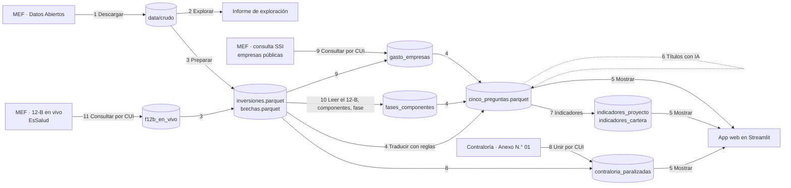

# Mapa de procesos

El código sigue esta numeración: cada script empieza con el número de su proceso. El orden para correrlos es 1 → 11 → 3 → 9 → 10 → 4 → 7 → 8 → 5 (el 2 y el 6 son opcionales). El 11 va antes del 3 (el 3 usa el 12-B en vivo de EsSalud); el 9 y el 10, antes del 4, que usa sus resultados. Las fechas de los datos quedan en `data/procesado/fechas.json`.

| N.º | Proceso | Insumo | Método | Resultado | Archivo |
|---|---|---|---|---|---|
| 1 | Descargar | Portal de Datos Abiertos del MEF | Descarga de 3 archivos públicos y anota la fecha | `data/crudo/*.csv` (≈ 537 MB, no se suben a GitHub) y `data/procesado/fechas.json` | `scripts/01_descargar.py` |
| 2 | Explorar | Los 3 archivos crudos | La lista de revisión: tamaño, tipos, duplicados, faltantes, atípicos | `docs/exploracion_resultados.md` e `informe_exploracion.md` | `scripts/02_explorar.py` |
| 3 | Preparar | Archivos crudos, `respaldo_12b.parquet` y el 12-B en vivo de EsSalud (Proceso 11) | Filtrar el gobierno nacional y los gobiernos regionales, un identificador único por fila, convertir tipos, marcar valores imposibles, unir brecha y 12-B (textos y programación mensual; si el MEF publica el 12-B vacío, su última copia válida; los textos de EsSalud, en vivo), ocultar nombres y correos (`scripts/privacidad.py`); agregar el nivel, la cartera, el tipo de inversión en 4 grupos y las etapas de los formatos 8 y 9 | `data/procesado/inversiones.parquet` (26 250 × 87), `brechas.parquet` y `respaldo_12b.parquet` | `scripts/03_preparar.py` |
| 4 | Traducir | Base preparada y gasto de las empresas públicas (Proceso 9) | Completar el gasto de EsSalud y FONAFE con su reporte a FONAFE (fuente del gasto: SIAF, FONAFE o «Sin dato»); reglas en lenguaje simple: ¿qué es?, ¿qué problema resuelve?, ¿cuánto?, ¿cuándo? (con periodo y duración), ¿cómo va? | `data/procesado/cinco_preguntas.parquet` | `scripts/04_traducir.py` |
| 5 | Mostrar | Las cinco preguntas y los indicadores de cartera | App web en Streamlit: nueve listas, cada una con «Todos» (nivel de gobierno → sector o gobierno regional → pliego → unidad ejecutora, más tipo de inversión, componentes, fase, presupuesto y estado) y un interruptor para mostrar las ya ejecutadas (ocultas por defecto); para lo elegido, el esquema de la cartera (con sangrías, se abre y se cierra) y el flujo de fases con la prioridad del MEF, los indicadores ("¿Cómo está la cartera?", calculados en el momento con `app/resumen_cartera.py`), la lista ordenable de proyectos (hasta 2 000 filas; con un buscador y un marcador de departamentos, de uno o varios, que acota la lista y el mapa), el mapa y la ficha de cada proyecto (con el recuadro de la Contraloría si la obra está paralizada). Portafolios A y B: casillas en la lista, comparación con los mismos indicadores, y se guardan en el enlace o en un CSV | Página web | `app/app.py`, `app/vistas.py`, `app/resumen_cartera.py` y `app/portafolios.py` |
| 6 | Títulos de alcance con IA | Nombre oficial y "alternativa" (descripción técnica) de cada proyecto | Gemini 3.5 Flash-Lite con salida estructurada en JSON, 20 proyectos por pedido; control: se descartan los títulos con cifras que no están en el texto del MEF | `data/procesado/ia_titulos.parquet`, que la app usa en lugar del nombre oficial. Por ahora solo el gobierno nacional; los regionales se titulan con `--incluir-regionales` | `scripts/06_ia.py` |
| 7 | Calcular indicadores de cartera | Cinco preguntas y todas las brechas | P1 brecha, P2 presupuesto pendiente, P3 desviación del costo, P4 problemas del 12-B (reglas de palabras), P5 financiamiento, P7 atraso y cumplimiento de la programación 2026, y avance frente a gasto (avance declarado ÷ gastado hasta el mes de la declaración: una aproximación al valor ganado; se calcula, pero no se muestra en la app porque el avance es autodeclarado) | `data/procesado/indicadores_proyecto.parquet` (26 412 filas), `indicadores_cartera.parquet` (66 filas: 33 sectores del nivel nacional, 30 entidades del nivel regional, los 2 niveles y el portafolio total) y `docs/indicadores_resultados.md` | `scripts/07_indicadores.py` (la fórmula de las tarjetas está en `app/resumen_cartera.py`, que usan el script y la app) |
| 8 | Obras paralizadas según la Contraloría | Anexo N.° 01 del informe de obras paralizadas a junio de 2026 (2 262 obras, Excel de gob.pe) y `inversiones.parquet` | Descargar el anexo, limpiar la causa (sin su número de código), convertir el avance físico y el año a número, y unir por el CUI | `data/contraloria/anexo_01_…xlsx` y `data/procesado/contraloria_paralizadas.parquet` (551 obras de 519 proyectos) | `scripts/08_contraloria.py` |
| 9 | Gasto de las empresas públicas | `inversiones.parquet` (qué inversiones consultar) y el servicio del MEF que alimenta la sección «Información financiera – Empresas públicas» de la consulta SSI (`invierteWS/Ssi/traeFonafeSSI`) | Consultar una a una, con una pausa, las 1 944 inversiones de EsSalud y de empresas de FONAFE sin gasto en el SIAF (las respuestas se guardan en `data/crudo/empresas/`); sumar solo los meses ya reportados; presupuesto 2026 = PIM o, si no hay, PIA; corregir 4 acumulados imposibles | `data/procesado/gasto_empresas.parquet` (1 944 filas; 748 con dato) | `scripts/09_gasto_empresas.py` |
| 10 | ¿Ya se ejecutó?, componentes, fase y prioridad | `inversiones.parquet` (textos del 12-B, avance declarado, formatos 8 y 9, nombre, descripción técnica y tipología) | Lectura del 12-B con reglas de palabras revisadas a mano (categoría, detalle y próximos pasos; ya ejecutada también si declaró 100 % o registró su formato de cierre pendiente de liquidación); componentes deducidos del nombre (IOARR: «ACCIÓN DE ACTIVOS») y de la descripción técnica: infraestructura, equipamiento, gestión e intangibles; fase = la más avanzada entre el 12-B, la etapa del formato 8 y el avance físico; grupo del orden de prelación del MEF (Directiva 001-2019-EF/63.01, art. 15.2) | `data/procesado/fases_componentes.parquet` (una fila por inversión) | `scripts/10_fases_componentes.py` |
| 11 | 12-B en vivo de EsSalud | `DETALLE_INVERSIONES.csv` (qué inversiones) y el servicio del MEF que alimenta la página del 12-B (`invierteWS/Ssi/traeInfSeguimF12B`) | Consultar una a una, con pausa, las ≈ 800 inversiones de EsSalud; quitar la fecha inicial, ocultar nombres y correos; conservar la categoría de la situación y los próximos pasos, que el archivo abierto no trae | `data/procesado/f12b_en_vivo.parquet` (respuestas en `data/crudo/f12b_vivo/<fecha>/`, no se suben) | `scripts/11_12b_en_vivo.py` |
| — | Probar | `app/app.py` | Prueba automática: carga, cada nivel, las 63 carteras, pliego, unidad, tipo y estado, ficha por enlace, mapa, búsqueda, recuadro de la Contraloría, portafolios A y B y su archivo CSV, fichas de empresas públicas con y sin dato de FONAFE, interruptor de las ya ejecutadas, filtro de componentes, orden por prioridad del MEF, filtro de fase, ficha de una inversión de la pandemia de EsSalud y marcador de departamentos (Lima y Callao) | Errores encontrados (hoy: 0) | `scripts/probar_app.py` |

