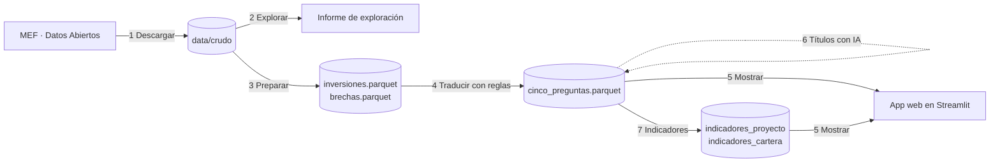

# Mapa de procesos

El código sigue esta numeración: cada script empieza con el número de su proceso. El orden para correrlos es 1 → 3 → 4 → 7 → 5 (el 2 y el 6 son opcionales).

| N.º | Proceso | Insumo | Método | Resultado | Archivo |
|---|---|---|---|---|---|
| 1 | Descargar | Portal de Datos Abiertos del MEF | Descarga de 3 archivos públicos | `data/crudo/*.csv` (≈ 537 MB, no se suben a GitHub) | `scripts/01_descargar.py` |
| 2 | Explorar | Los 3 archivos crudos | La lista de revisión: tamaño, tipos, duplicados, faltantes, atípicos | `docs/exploracion_resultados.md` e `informe_exploracion.md` | `scripts/02_explorar.py` |
| 3 | Preparar | Archivos crudos | Filtrar el gobierno nacional y los gobiernos regionales, convertir tipos, marcar valores imposibles, unir brecha y 12-B (textos y programación mensual), ocultar nombres y correos; agregar el nivel, la cartera (sector o gobierno regional) y el tipo de inversión en 4 grupos (proyecto, IOARR, IRI, programas y otros) | `data/procesado/inversiones.parquet` (26 412 × 79) y `brechas.parquet` (38 094 brechas) | `scripts/03_preparar.py` |
| 4 | Traducir | Base preparada | Reglas en lenguaje simple: ¿qué es?, ¿qué problema resuelve?, ¿cuánto?, ¿cuándo? (con periodo y duración), ¿cómo va? | `data/procesado/cinco_preguntas.parquet` | `scripts/04_traducir.py` |
| 5 | Mostrar | Las cinco preguntas y los indicadores de cartera | App web en Streamlit: seis listas, cada una con «Todos» (nivel de gobierno → sector o gobierno regional → pliego → unidad ejecutora, más tipo de inversión y estado); para lo elegido, el árbol de la cartera, los indicadores ("¿Cómo está la cartera?", calculados en el momento con `app/resumen_cartera.py`), la lista ordenable de proyectos (hasta 2 000 filas), el mapa y la ficha de cada proyecto | Página web | `app/app.py` y `app/resumen_cartera.py` |
| 6 | Títulos de alcance con IA | Nombre oficial y "alternativa" (descripción técnica) de cada proyecto | Gemini 3.5 Flash-Lite con salida estructurada en JSON, 20 proyectos por pedido; control: se descartan los títulos con cifras que no están en el texto del MEF | `data/procesado/ia_titulos.parquet`, que la app usa en lugar del nombre oficial. Por ahora solo el gobierno nacional; los regionales se titulan con `--incluir-regionales` | `scripts/06_ia.py` |
| 7 | Calcular indicadores de cartera | Cinco preguntas y todas las brechas | P1 brecha, P2 presupuesto pendiente, P3 desviación del costo, P4 problemas del 12-B (reglas de palabras), P5 financiamiento, P7 atraso y cumplimiento de la programación 2026, y avance frente a gasto (avance declarado ÷ gastado hasta el mes de la declaración: una aproximación al valor ganado; se calcula, pero no se muestra en la app porque el avance es autodeclarado) | `data/procesado/indicadores_proyecto.parquet` (26 412 filas), `indicadores_cartera.parquet` (66 filas: 33 sectores del nivel nacional, 30 entidades del nivel regional, los 2 niveles y el portafolio total) y `docs/indicadores_resultados.md` | `scripts/07_indicadores.py` (la fórmula de las tarjetas está en `app/resumen_cartera.py`, que usan el script y la app) |
| — | Probar | `app/app.py` | Prueba automática: carga, cada nivel, las 63 carteras, pliego, unidad, tipo y estado, ficha por enlace, mapa y búsqueda | Errores encontrados (hoy: 0) | `scripts/probar_app.py` |

