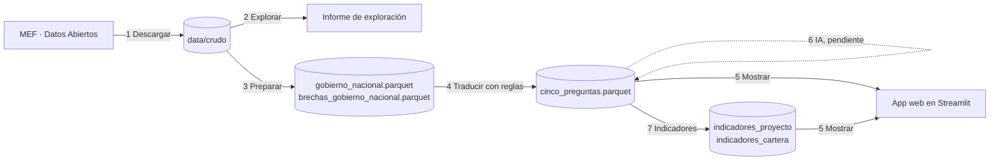

# Mapa de procesos

El código sigue esta numeración: cada script empieza con el número de su proceso. El orden para correrlos es 1 → 3 → 4 → 7 → 5 (el 2 y el 6 son opcionales).

| N.º | Proceso | Insumo | Método | Resultado | Archivo |
|---|---|---|---|---|---|
| 1 | Descargar | Portal de Datos Abiertos del MEF | Descarga de 3 archivos públicos | `data/crudo/*.csv` (≈ 537 MB, no se suben a GitHub) | `scripts/01_descargar.py` |
| 2 | Explorar | Los 3 archivos crudos | La lista de revisión: tamaño, tipos, duplicados, faltantes, atípicos | `docs/exploracion_resultados.md` e `informe_exploracion.md` | `scripts/02_explorar.py` |
| 3 | Preparar | Archivos crudos | Filtrar el gobierno nacional, convertir tipos, marcar valores imposibles, unir brecha y 12-B (textos y programación mensual), ocultar nombres y correos | `data/procesado/gobierno_nacional.parquet` (12 731 × 62) y `brechas_gobierno_nacional.parquet` (17 119 brechas) | `scripts/03_preparar.py` |
| 4 | Traducir | Base preparada | Reglas en lenguaje simple: ¿qué es?, ¿qué problema resuelve?, ¿cuánto?, ¿cuándo? (con periodo y duración), ¿cómo va? | `data/procesado/cinco_preguntas.parquet` | `scripts/04_traducir.py` |
| 5 | Mostrar | Las cinco preguntas y los indicadores de cartera | App web en Streamlit: cartera completa o ministerio → seis indicadores ("¿Cómo está la cartera?") → árbol → proyectos → ficha con siete preguntas | Página web | `app/app.py` |
| 6 | Redactar con IA *(código listo; falta la clave en `.env`)* | Nombre, descripción técnica, brecha y textos del 12-B | LLM con salida estructurada en JSON: ¿qué es?, ¿qué problema resuelve? y ¿qué lo frena?, solo con los datos dados | `data/procesado/ia_respuestas.parquet`, que la app usa si existe | `scripts/06_ia.py` |
| 7 | Calcular indicadores de cartera | Cinco preguntas y todas las brechas | P1 brecha, P2 presupuesto pendiente, P3 desviación del costo, P4 problemas del 12-B (reglas de palabras), P5 financiamiento, P7 atraso y cumplimiento de la programación 2026 | `data/procesado/indicadores_proyecto.parquet` (12 731 filas), `indicadores_cartera.parquet` (33 ministerios o entidades + la cartera completa) y `docs/indicadores_resultados.md` | `scripts/07_indicadores.py` |
| — | Probar | `app/app.py` | Prueba automática: carga, ficha, cambio de ministerio y cartera completa | Errores encontrados (hoy: 0) | `scripts/probar_app.py` |

